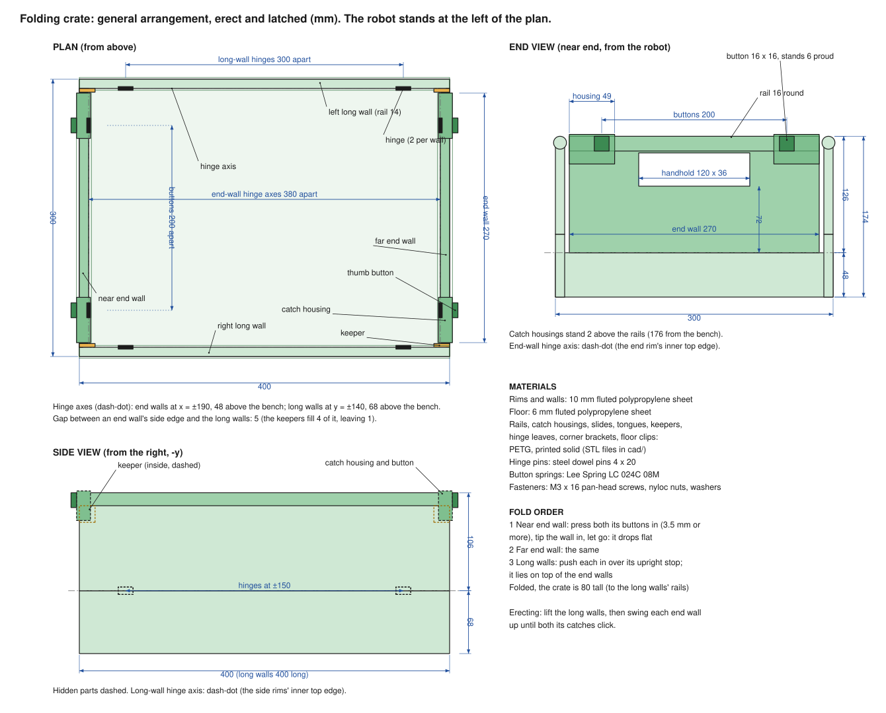
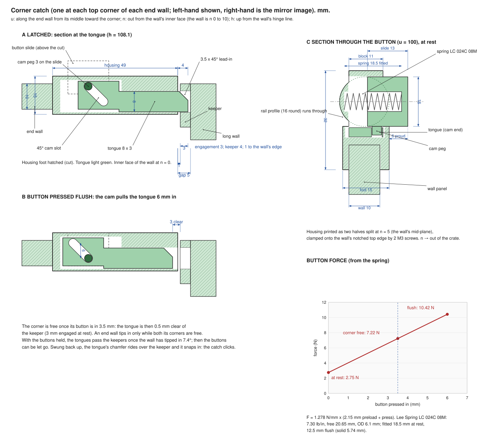
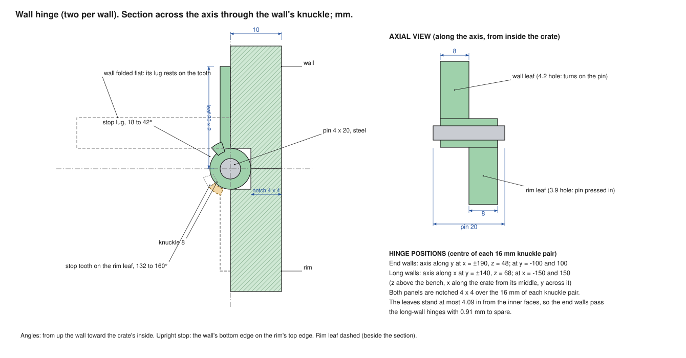
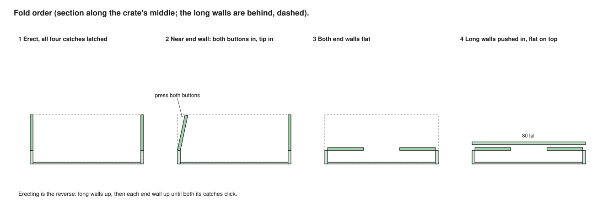

# Fold a collapsible crate flat for storage

An empty green folding crate stands up on the table between the two arms. It is the everyday collapsible plastic
crate people use for shopping, the car boot, laundry and home storage: 400 x 300 x 174 mm, 1.03 kg. Its 400 mm length
points away from the robot, so one short end wall faces the robot and the other faces away. The job is the whole real
one: fold the crate flat, then bring both arms back. The robot is told only:

> Fold the empty crate flat for storage, and finish with both arms back where they started.

Files:

- [`fold_a_produce_crate_flat_for_return.py`](fold_a_produce_crate_flat_for_return.py): the task for the `yam_arena`
  embodiment (scene, scoring and the scripted demo). It imports [`bodykit.py`](bodykit.py) from the same folder.
- [`drawings/`](drawings): four dimensioned drawings of the crate as built (SVG).
- [`cad/`](cad): STL files of every 3D-printed part.

What it tests: freeing a latched wall by holding two sprung catches open at the same time, 200 mm apart and each
against 7.2 N of spring at its release point, with a squeeze that does not shove the light crate along the table. Then
the fold order the hardware sets: both end walls down first, then the long walls on top. The crate must end flat with
nothing holding it. A snap-fit or "press until it clicks" task needs one press; here two catches must stay open
together while the wall is tipped, and the order is enforced by the crate itself.

Why two hands:

- Each end wall is latched to the long walls by a sprung catch at each of its top corners. The two thumb buttons are
  200 mm apart, too far for one gripper, and while either catch is latched the wall stays up.
- A button pushed from outside alone shoves the crate along the table. The crate slides at about 3.5 N (1.03 kg,
  friction 0.35), while the button needs 7.2 N to reach its release point. Squeezing the button and the top rail
  together holds it in without moving the crate.
- With one hand (the right doing exactly its part of the demo, the left never moving) the demo scored 0:
  - the right squeezed the near end wall's right-hand button 4.9 mm in, but the other catch held the wall;
  - tipping it dragged the whole crate 14 mm along the table while the wall turned 0.3 degrees;
  - the far end wall's pinch then missed its button, and the push on the right long wall, still held up by the latched
    end walls, shoved the crate 58 mm sideways;
  - nothing folded, and no catch was forced.

## Why it matters

Collapsible crates are a familiar household item. They are sold for a few dollars or pounds at warehouse clubs,
supermarkets and DIY stores, and people fold and unfold them every time they put them away:

- Costco's Greenmade InstaCrate, 12 gallons, $6.99 to $9: "When collapsed they are only 2.75″ high!" The write-up lists
  groceries, laundry, carrying things up and down stairs, files, a camper and a truck bed
  ([hip2save, 2023](https://hip2save.com/deals/instacrate/)).
- Wickes' Keeeper 32 L folding crate, £4.25, "ideal for various applications, such as shopping or tidying up", for the
  house, the car and the garden ([Wickes](https://www.wickes.co.uk/Keeeper-Black-Folding-Crate---32L/p/311363)).
- B&Q's Thumbs Up 32 L folding crate: "Open size: (L)48cm x (W)36cm x (H)24cm", "Folded size: (L)48cm x (W)36cm x
  (H)5cm"
  ([B&Q](https://diy.com/departments/4-x-thumbs-up-32-litre-silver-folding-crate-collapsible-plastic-storage-box/2500002468443_BQ.prd)).
- Mount-It's folding storage crate sold at Target as "Trunk Storage": "Collapses down to 3" for easier portability and
  storage"
  ([Target](https://www.target.com/p/mount-it-folding-plastic-storage-crates-folding-crate-durable-plastic-container-trunk-storage/-/A-89164502)).
- Many fold the way this one does. Bag-A-Nut's collapsible crate: "Using your thumbs, press buttons on the short ends
  and fold the flaps down", then "Fold the long sides in"
  ([Bag-A-Nut](https://baganut.com/product/collapsible-storage-bin-39-liter-foldable-crate-stackable-plastic-utility-basket/)).

Anyone who has used one recognises the job in a few seconds of video: both thumbs on the short side's catches, the
side folds in, then the long sides go down on top.

## The crate as built

No crate on sale was found whose catch, button and dimensions are published, and we have none to measure. So the crate
is specified to be built, and the simulation uses this specification's numbers exactly. **Every dimension, spring
setting and mass below is our design choice for this build, not a measurement of a product.** The masses are computed
from the parts (sheet weights from the maker's data sheet, printed volumes from the STL files), so a builder should
weigh the finished crate (1.03 kg, within about 10 %).

### Drawings









### Crate body (mm)

| Part | Size | Material | Notes |
|---|---|---|---|
| Floor | 380 x 280 x 6 | 6 mm fluted PP sheet | inside the rims, held by 8 printed clips |
| Side rims (2) | 400 x 68 x 10 | 10 mm fluted PP | long walls hinge on their inner top edges |
| End rims (2) | 280 x 48 x 10 | 10 mm fluted PP | between the side rims; end walls hinge on their inner top edges |
| End walls (2) | panel 270 x 112, 126 tall with the rail | 10 mm fluted PP + PETG rail | 120 x 36 handhold at 72 to 108 above the hinge line; 16 mm round rail, axis 118 above the hinge line, sitting on the panel in a 2 mm seat; panel's top corners notched 49 x 8 under the catch housings |
| Long walls (2) | panel 400 x 99, 106 tall with the rail | 10 mm fluted PP + PETG rail | 14 mm rail, round on top, square below its axis, slotted over the panel's top edge (two 200 mm halves) |

The end walls are 270 mm wide, leaving a 5 mm gap to the long walls on each side. Folded flat, the crate is 80 mm tall
(to the long walls' rails); the end walls lie lowest, the long walls just above them.

### Hinges

- Two per wall, each a printed wall leaf and rim leaf whose 8 mm knuckles sit side by side on one 4 x 20 mm steel dowel
  pin. The pin is pressed into the rim knuckle (3.9 mm hole) and turns in the wall knuckle (4.2 mm hole).
- The axis is the rim's inner top edge: end walls at x = ±190 mm, 48 mm above the table; long walls at y = ±140 mm, 68
  mm above the table (x along the crate from its middle, y across it).
- Hinges sit at y = -100 and 100 on the end walls, and at x = -150 and 150 on the long walls. Both panels are notched
  4 x 4 mm over the 16 mm of each knuckle pair.
- Stops: upright, the wall's bottom edge rests on the rim's top edge. Flat (90 degrees), a lug on the wall knuckle meets
  a tooth on the rim leaf. A check of the two STL leaves turned about the pin shows no overlap up to 90.0 degrees and
  contact beyond it.
- The leaves stand at most 4.09 mm in from the inner faces, so the end walls pass the long walls' hinges with 0.91 mm
  to spare.

### Corner catches (four)

| Item | Value |
|---|---|
| Thumb button | 16 x 16 mm face, 100 mm either side of the end wall's middle (200 mm apart), at the rail's axis height; stands 6 mm out of the rail's outer face; travel 6 mm to flush |
| Slide | 16 x 16 x 13 mm PETG, the button is its outer end; 3.8 g |
| Spring | Lee Spring LC 024C 08M, music wire: 6.10 mm OD, 0.61 mm wire, 20.65 mm free, solid 5.74 mm, 7.30 lb/in = 1.278 N/mm |
| Spring fit | in an 11 mm deep, 6.4 mm bore in the slide, seated on the housing's back: 18.5 mm long at rest (2.15 mm preload), 12.5 mm flush |
| Button force | F = 1.278 N/mm x (2.15 mm + press): 2.75 N at rest, **7.22 N at 3.5 mm (corner free)**, 10.42 N flush |
| Energy to free one corner | ½ x 1.278 x (5.65² - 2.15²) = 17.5 mJ |
| Cam | a 3 mm peg under the slide runs in a 45 degree slot in the tongue, so the tongue moves in exactly as far as the button |
| Tongue | 8 x 3 mm PETG blade, stands 4 mm out of the wall's side edge at rest, 3.5 x 45 degree lead-in on its tip's outer corner |
| Keeper | 17 x 4 x 18 mm PETG block on each end of each long wall's inner face (142 to 160 mm above the table), with an 8.4 x 3.4 mm slot; 1 mm from the end wall's edge |
| Engagement | 3 mm of tongue in the keeper's slot; the corner is free once the button is in 3.5 mm (0.5 mm clearance) |
| Housing | 49 mm long (to the wall's side edge), 32 mm tall: a block inside the rail's outline from 110 to 128 mm above the hinge line, a foot below the rail with an 8 mm slot for the panel, and the rail's round profile running through. Printed as two halves split on the wall's mid-plane, clamped onto the panel by two M3 screws |
| Release | an end wall tips in only while both its corners are free; with the buttons held, the tongues are past the keepers once the wall has tipped in 7.4 degrees |
| Latching | swung back up, each tongue's lead-in rides over its keeper and snaps into the slot: the catch clicks |

The spring: 7.30 lb/in x 4.448 N/lb ÷ 25.4 mm/in = 1.278 N/mm. Fully compressed it would carry about 19 N (1.278 N/mm
x 14.91 mm of travel to its 5.74 mm solid height); the fit uses 8.15 mm of that travel. The tongue needs no spring of
its own: the cam drives it both ways, so the force at the button is the spring's force plus a little sliding
friction.

### Fold order

1. Near end wall: press both its buttons in at least 3.5 mm, tip the wall in, and let go: it drops flat on its hinges.
2. Far end wall: the same.
3. Long walls: push each in over its upright stop; it folds down on top of the end walls. A long wall's keepers bear
   on the side edge of any end wall still standing, so it cannot fold before both end walls are down.

Erecting is the reverse: lift the long walls, then swing each end wall up until both its catches click.

### Parts list

Prices were checked on 2026-11-16 except where marked.

| Part | Qty | Source and part number | Price |
|---|---|---|---|
| 10 mm fluted polypropylene sheet, 48 x 96 in (rims, walls) | 1 sheet (0.32 m² used) | Coroplast 10 mm white, SKU 17972, [bciimage](https://bciimage.com/?p=213241). Weight used: Primex Prime COR-X 10 mm, 2,131 g/m² ([data sheet](https://www.primexplastics.com/wp-content/uploads/primex-data-sheet-corxpp-1.pdf)) | $107.78 |
| 6 mm fluted polypropylene sheet (floor, 380 x 280) | 1 piece | Primex Prime COR-X 6 mm, 1,109 g/m² (same data sheet), or any 6 mm Coroplast | not priced |
| PETG filament | 325 g | e.g. [Prusament PETG 1 kg](https://www.prusa3d.com/product/prusament-petg-jet-black-1kg/) (1.27 g/cm³, data sheet) | $23.99 per kg |
| Compression spring | 4 | Lee Spring LC 024C 08M (specs from Lee Spring's 2014 catalogue, standard series, page 73; [catalogue copy](https://www.rcfastener.com/documents/2014_Lee_Spring_Catalog.pdf)) | 2014 list: $6.17 each for 10 to 19 (not rechecked) |
| Dowel pin, M4 x 20 mm, ISO 2338 h8, stainless | 8 | Olander [.4R20DOWS](https://www.olander.com/items/.4R20DOWS) | $0.629 each |
| M3 x 16 pan-head screw, M3 nyloc nut, M3 washer | 72 sets | any hardware store | not priced |

The priced items come to about $182: one whole 4 x 8 ft sheet (a tenth of it is used), 325 g of PETG ($7.80), ten
springs at the 2014 price ($61.70; Lee Spring bills 1 to 9 pieces at the 10-piece price) and eight pins ($5.03). With
the 6 mm floor piece and the screws the crate costs roughly $200 to $250 (an estimate).

Printed parts: PETG, 100 % infill (the masses assume solid parts), 0.2 mm layers. Each file is in its drawing's frame;
turn it onto a flat face in the slicer.

| STL file | Qty | Size (mm) | Mass each (g) |
|---|---|---|---|
| `catch_housing_inner_half.stl` | 4 (2 mirrored) | 49 x 8 x 32 | 7.6 |
| `catch_housing_outer_half.stl` | 4 (2 mirrored) | 49 x 8 x 32 | 8.7 |
| `button_slide.stl` | 4 | 16 x 13 x 19 | 3.8 |
| `tongue.stl` | 4 (laid upside down for the right-hand corners) | 43 x 12 x 3 | 1.3 |
| `keeper.stl` | 4 (2 mirrored) | 17 x 4 x 18 | 1.3 |
| `end_wall_rail.stl` | 2 | 172 x 16 x 26 | 41.8 |
| `long_wall_rail_half.stl` | 4 | 200 x 14 x 14 | 25.8 |
| `hinge_leaf_wall.stl` | 8 | 8 x 8 x 24 | 0.7 |
| `hinge_leaf_rim.stl` | 8 | 16 x 8 x 24 | 0.8 |
| `base_corner_bracket.stl` | 4 | 25 x 25 x 40 | 5.9 |
| `floor_clip.stl` | 8 | 15 x 15 x 20 | 1.5 |

### Masses

| Body | Mass | Made of |
|---|---|---|
| Base | 413 g | rims 173.2 g and floor 118.0 g of sheet, corner brackets 23.7 g, floor clips 11.9 g, rim hinge leaves 6.0 g, hinge pins 15.9 g (8 x 1.99 g), 40 M3 screw sets 64.0 g |
| End wall (each, without its buttons) | 146 g | panel 53.6 g, rail 41.8 g, two housings 32.7 g, two tongues 2.7 g, two springs 0.7 g, two hinge leaves 1.4 g, 8 M3 screw sets 12.8 g |
| Long wall (each) | 153 g | panel 84.4 g, rail 51.7 g, two keepers 2.7 g, two hinge leaves 1.4 g, 8 M3 screw sets 12.8 g |
| Button slide (each) | 3.8 g | PETG |
| Whole crate | 1.03 kg | 413 + 2 x 146 + 2 x 153 + 4 x 3.8 = 1,026 g |

Sheet masses are area x the data sheet's weight per square metre; printed masses are the STL volume x 1.27 g/cm³. Each
M3 screw set (screw, nut, washer) is taken as 1.6 g, an estimate from nominal sizes. The end wall's centre of mass is
5.1 mm out from its hinge line and 87.2 mm up, so a free end wall stands on its upright stop until it is tipped in 3.3
degrees; a long wall's (4.8 mm, 68.7 mm) gives 4.0 degrees.

### Building it

1. Cut the panels with a utility knife and a straightedge: flutes vertical in walls and rims. Cut the end walls'
   handholds and 49 x 8 mm top-corner notches, and a 4 x 4 mm notch over each 16 mm hinge position in the walls'
   bottom edges and the rims' top edges.
2. Base: stand the rims round the floor, join the corners with the four corner brackets (four M3 screws each) and the
   floor to the rims with the eight clips.
3. Rails: slide each long wall's two rail halves over its top edge and screw them through (two M3 each). Seat each end
   wall's rail on its panel between the corner notches and screw it through its two tabs.
4. Catches: lay the tongue in the inner housing half, put the spring in the slide's bore, set the slide in with its
   peg in the tongue's slot, and close the outer half over the panel's notched corner with two M3 screws through both
   halves and the panel. Check: pressed flush, the button pulls the tongue 6 mm in; released, the tongue stands 4 mm out
   of the wall's side edge.
5. Keepers: screw one to each end of each long wall's inner face, flush with the wall's end, 74 to 92 mm above the
   panel's bottom edge, with one countersunk M3 screw (nut outside).
6. Hinges: screw the leaves to the panels' inner faces (one M3 each), line up the knuckles on the joint line and press
   the pin through the wall knuckle into the rim knuckle.
7. Check: each end wall clicks into both keepers when swung up and frees when both buttons are pressed 3.5 mm or more;
   a long wall will not fold while an end wall stands; folded height 80 mm; the crate weighs about 1.03 kg.

### Real-trial safety and rig protection

- Nothing in the trial can contaminate or damage the shared rig: the crate is dry polypropylene sheet and PETG, with
  no liquid, food or grease, and it weighs 1.03 kg.
- Deburr the cut edges of the sheet and the printed parts before the first trial, so nothing sharp meets the gripper
  pads.
- The largest force the task needs is a button pressed flush, 10.4 N, well inside the roughly 40 N a YAM finger gives.
- The crate stands on the table and folds downward, so nothing can fall far or fly off.

## How it is modelled

The crate is nine loose rigid bodies made of shapes from `bodykit.py`, at the build's sizes, masses and centres of
mass:

| Body | Mass | Shapes |
|---|---|---|
| base | 0.413 kg | 6 mm floor; side rims 68 mm tall, end rims 48 mm tall, 10 mm thick |
| 2 end walls | 0.146 kg each | 270 x 126 mm, 10 mm panel with the handhold, 16 mm round rail, two catch housings (block and foot) |
| 2 long walls | 0.153 kg each | 400 x 106 mm, 10 mm panel, 14 mm rail with its square foot, a keeper at each end |
| 4 thumb buttons | 3.8 g each | 16 x 16 mm, 6 mm thick |

- **Hinges.** Each wall hangs on a PhysX revolute joint on the build's hinge axis (the rim's inner top edge), with
  limits at upright and at lying flat.
- **Buttons.** Each rides on a prismatic joint in its housing with 6 mm of travel. Its drive is the specified spring:
  1,278 N/m, its target 2.15 mm beyond the outer stop. That gives 2.75 N at rest, 7.22 N at 3.5 mm and 10.42 N flush,
  as in the build.
- **Catches.** A latched end wall is held upright by a stiff hinge spring (1.2 N m per degree); this stands in for the
  tongues in their keepers. It lets go when both of that wall's buttons are in 3.5 mm or more at the same time, the
  point where the built tongues clear their keepers. The wall is then free on its hinge, against light hinge friction.
  Swung back up to within 1 degree of upright with both buttons out, it latches again.
- **Long walls.** Each is held up by the same kind of spring while either end wall is latched. Its keepers also bear
  physically on a standing end wall's side edge (1 mm away), as in the build.
- **Order.** It is set by the hardware, as on the real crate. The long walls cannot fold while an end wall is latched,
  and a long wall lying flat blocks the end walls under it from coming down.
- **Friction.** Polypropylene friction is 0.35 against the table (the lower of the two is used). PhysX runs at 240 Hz,
  the arms at 20 Hz.
- **Not modelled:** the cams and tongues (the hinge-spring latch above stands in for them), the hinge leaves and pins
  (the joints are ideal hinges on the same axes), the end rails' screw tabs, screws, brackets and floor clips. The
  walls are solid plates of the panels' outer size. The dark vent and floor-lattice patches are painted on (visual
  only); the built panels are plain sheet.

## Scoring

Followed over the whole trial, a trial scores 0 for good if:

- the crate falls off the table (its base more than 10 cm below the table top); or
- a catch is forced: a latched end wall, or a long wall held up by a latched end wall, is pushed in more than
  3 degrees (about 30 N at its top rail).

Judged at the end, on live states, a wall lies flat when it is within 5 degrees of its folded stop.

- **1.0** needs all of these:
  - all four walls flat, with the long walls over the flat end walls;
  - the folded crate under 90 mm tall at its highest point;
  - its base on the table and within 3 degrees of level;
  - both arms back where they started (each gripper's fingertip centre within 5 cm of its start).
- **Otherwise:** 0.2 for each end wall lying flat, plus 0.2 for each long wall lying flat over both flat end walls,
  at most 0.8.

The trial ends at the run limit, or once the full score has held for 1 s with the crate and its walls still.

In a real trial:

- measure the folded height with a ruler (under 90 mm);
- check from the video that the crate stayed on the table, that each wall ended lying on its flat stop, and that the
  long walls lie over the end walls;
- check the arms against tape marks at their start;
- judge a forced catch by inspection after the trial: stand each end wall back up. Both its catches must click in, no
  tongue may be bent or cracked, and no keeper cracked or whitened. Any such damage, or a catch that no longer engages,
  scores 0.

The built catch is rigid, so a latched wall cannot be pushed in without damaging a catch. The simulation's latch gives
slightly and flags a push past 3 degrees, about 30 N, which is stricter. For scale, each tongue's 3 x 8 mm section at
the PETG data sheet's 18 MPa interlayer adhesion would take roughly 430 N to shear.

## Run and score a trial

The scorer is `task_score`: 1.0 when `success()` (full score with the crate and its walls still) has held for 1 s,
otherwise `score()` at the end of the episode. `-E object_jitter=0` keeps the crate exactly where the task file puts
it, so every trial starts from the same layout. The cameras render at 1280 x 704 for sharp videos. Dream-1's client
scales every frame to 320 x 176 before sending it, so `-E cam_width=320 -E cam_height=176` gives the policy the same
input.

Dream-1 (needs a key in `~/.dreamlabs/credentials`):

```bash
inspect-robots run --embodiment yam_arena --policy dream \
  -E task=fold_a_produce_crate_flat_for_return.py -E object_jitter=0 -E control_hz=20 -E cam_width=1280 -E cam_height=704 \
  --instruction "Fold the empty crate flat for storage, and finish with both arms back where they started." \
  --scorer task_score --max-steps 1600 --store-frames --log-dir ~/yam-eval/crate-dream
```

The scripted demo reaches full score from fixed waypoints and reads no simulator state.

1. Both hands go to the near end wall's top corners. Each pinches the top rail with the thumb button under its outer
   finger, the grips leaning 15 degrees forward. The squeeze presses both buttons in without pushing the crate along.
2. Holding them in, both hands tip the wall in (the rail rolls in the grips), let go, and it drops flat.
3. The same at the far end wall.
4. With both end walls down, each hand pushes its long wall in over its stop from outside, and the wall drops flat on
   top.
5. Both arms go back to where they started, showing the folded crate.

Measured in a `CRATE_DEBUG=1` run of this demo (1.0, 525 steps):

- the squeezes pressed the near end wall's buttons 5.4 and 5.5 mm in, the far end wall's 6.1 and 6.6 mm (3.5 mm frees a
  corner);
- the near end wall lay flat by 8.5 s, the far one by 17.5 s and both long walls by 22.0 s;
- the crate moved 6 mm along the table in all, and no catch was forced;
- folded, it stood 80 mm tall;
- the full score held from 25.5 s, and the trial ended at 26.2 s (525 steps).

```bash
inspect-robots run --embodiment yam_arena --policy yam_scripted \
  -E task=fold_a_produce_crate_flat_for_return.py -E object_jitter=0 -E control_hz=20 -E cam_width=1280 -E cam_height=704 \
  --instruction "Fold the empty crate flat for storage, and finish with both arms back where they started." \
  --scorer task_score --max-steps 1600 --store-frames --log-dir ~/yam-eval/crate-demo
```

Videos, one MP4 per camera next to each run's frames:

```bash
for log in ~/yam-eval/crate-dream/*.json; do inspect-robots video "$log"; done
```

Set `CRATE_DEBUG=1` to print what the score is built from twice a second:

- each wall's fold angle;
- how far each button is pressed in;
- which end walls are latched and which long walls are held;
- whether a catch was forced;
- where the crate's base is and its tilt;
- the crate's height;
- where each TCP is, the finger openings, and whether the arms are home.

## Runtime per trial

On one RTX 5090: about 12 minutes for a Dream-1 trial of 1,600 steps (730 s on the clock, with Dream answering in 0.62 s on average), and about 4 minutes for the scripted demo (525 steps, 26.2 s of simulated time, 250 s on the clock). Isaac Sim's first start on a new machine adds a few minutes while it compiles its shaders.

## Seeds

None needed: with `-E object_jitter=0` the layout is fixed, and the scripted demo follows fixed waypoints.

## Third-party assets

None. The crate is built from primitive shapes in the task file; the robot, table and room are those of the
`yam_arena` embodiment.

## Changes in this revision

This is a revision of TK-6VPH8K. Its review said:

> Importance (not met): Stockers and hand packers unpack goods, but their total employment does not establish that over 500,000 workers regularly fold this two-button crate; folding a familiar storage crate could fit societal relatability.
>
> Clarity and reproducibility (not met): The modeled button placement, travel and force are inferred, and no specified purchasable crate is shown to have the modeled simultaneous-release mechanism and dimensions.
>
> What to change: The employment figures cover broad occupations and do not establish that 500,000 workers regularly fold a crate with this particular release mechanism. Please change the domain to societal relatability and explain the familiar everyday use of the folding crate. Also identify a purchasable crate with the two simultaneous corner releases, measure its button placement, travel and operating force, and update the setup and simulation to match it; alternatively provide buildable specifications for the complete mechanism. Demonstrate the resulting task within the run limit.

This is the first revision; there is no earlier review.

What changed in response:

- **Domain (Importance, not met):** the category is now Societal relatability. The title is "Fold a collapsible crate
  flat for storage" and the instruction says "for storage". The job counts are gone; "Why it matters" and the context
  present the everyday collapsible crate (shopping, the car boot, laundry, picnics, home storage), with retail listings
  and one maker's fold instructions.
- **Purchasable crate or buildable specifications (Clarity and reproducibility, not met):** we took the second route.
  No crate on sale publishes these catch dimensions, and we have none to measure. "The crate as built" gives the
  complete mechanism, and says that its numbers are design choices, not measurements:
  - four dimensioned drawings (`drawings/`): general arrangement; corner catch, sectioned latched and pressed, with the
    spring's force line; wall hinge; fold order;
  - STL files for all 11 printed parts (`cad/`);
  - a cut list, a parts list with part numbers and prices, assembly and check steps, and a mass budget.
- **Button placement, travel and force:** 16 x 16 mm buttons, 100 mm either side of the end wall's middle, 6 mm
  travel. Each rides on a Lee Spring LC 024C 08M (1.278 N/mm, 2.15 mm preload): 2.75 N at rest, 7.22 N at 3.5 mm,
  10.42 N flush. A 45-degree cam pulls a tongue in by the button's travel; the tongue engages its keeper 3 mm, so a
  corner is free at 3.5 mm.
- **Simulation updated to match:**
  - the buttons' drive is the specified spring (it was an estimate, 1,000 N/m and 3 mm preload);
  - the release point is the tongue's engagement plus clearance;
  - catch housings and keepers are in the scene, and the long walls are the full 400 mm;
  - masses and centres of mass are the build's: 1.03 kg in all (was 0.88 kg).
- **Real-trial scoring:** a forced catch is judged by inspection after the trial (each end wall must click back into
  both catches, with no bent tongue or cracked keeper).
- **Demonstrate the resulting task within the run limit:** the scripted demo reaches 1.0 in 525 steps (26.2 s; the
  run limit is 1,600) and ends with the crate folded 80 mm tall and both arms home. A new Dream-1 run scores 0.0; its
  arms never reached the crate. With one hand the demo scores 0.
